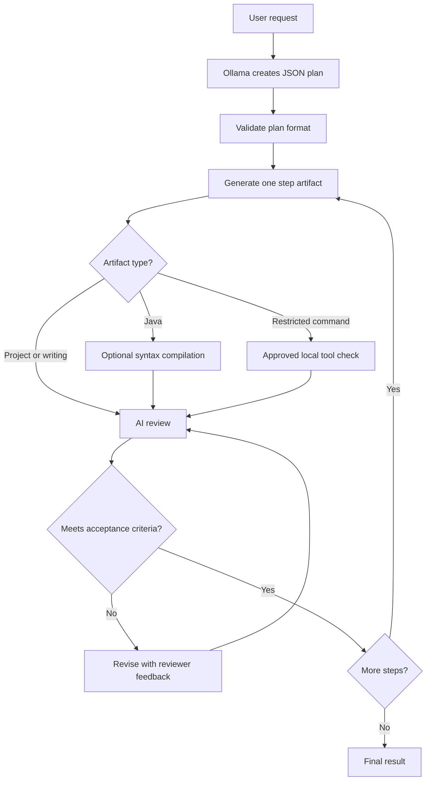

# Local Ollama Planner Agent

**A local-first, plan-driven AI assistant built with Java, Spring Boot, Ollama, and a lightweight web interface.**

The project explores how a smaller, non-agentic language model can be coordinated by an application to complete multi-step tasks. Instead of relying on the model to autonomously manage a long conversation, the application creates a structured plan, executes one step at a time, asks the model to review each result against the plan, and either revises or moves forward.

> **Status:** Experimental / under active development. AI-approved steps are not guaranteed to be correct or runnable. The current multi-file project workflow generates source files but does not automatically run full Gradle/Maven/npm builds.

## Highlights

- **Local LLM integration:** Uses installed Ollama models without requiring a cloud inference API key.
- **Model management:** List, select, load, and unload models from the browser; sort by name or model size.
- **Plan-first execution:** Turn a natural-language request into ordered steps with acceptance criteria.
- **Task-aware steps:** Support natural-language (`DIRECT`), standalone Java (`JAVA`), multi-file application (`PROJECT`), and restricted utility-command (`COMMAND`) steps.
- **AI review and revision:** Review the output of each step against its acceptance criteria and retry when rejected; no model-generated unit-test classes are required.
- **Live feedback:** Receive progress events in the UI using Server-Sent Events (SSE).
- **Stop control:** Request cancellation of a running generation or agent workflow.
- **Adjustable workspace:** Resize the step sidebar, activity panel, and input area.
- **File-oriented project output:** Represent Spring Boot/React-style outputs as separate named source files instead of one large text response.
- **Execution diagnostics:** Backend logs include task progression, elapsed time, and error stack traces.

## How it works



A typical plan has this structure:

```json
{
  "goal": "Build a Java program to calculate the sum of prime numbers",
  "steps": [
    {
      "stepNumber": 1,
      "description": "Implement the prime-number summation logic",
      "type": "JAVA",
      "acceptanceCriteria": "Return 0 for limits below 2 and the correct sum for higher limits"
    }
  ],
  "end": "END"
}
```

The plan is intentionally smaller than the final implementation: the model generates code or prose **when a step is executed**, not while drafting the entire plan. For multi-file tasks, the intended format is an artifact map such as:

```json
{
  "files": {
    "backend/build.gradle": "...",
    "backend/src/main/java/com/example/app/ItemController.java": "...",
    "frontend/src/App.jsx": "..."
  }
}
```

## Technology stack

| Area | Technology |
| --- | --- |
| Backend | Java 17, Spring Boot, Spring MVC |
| Local inference | Ollama HTTP API |
| Frontend | HTML, CSS, vanilla JavaScript |
| Real-time updates | Server-Sent Events (SSE) |
| JSON | Jackson |
| Local execution | Java compiler, `ProcessBuilder`, restricted tooling |
| Supported host environment | Windows with JDK, Ollama, and optional Node.js / npm and Gradle |

## Project layout

```text
src/main/
├── java/com/example/newaichatapp/agent/
│   ├── controller/       # Planning, streaming, cancellation, model APIs
│   ├── service/          # Planning, AI review, routing, code/tool execution
│   ├── model/            # Plans, steps, progress events, request/response DTOs
│   ├── config/           # Agent settings and async execution
│   ├── OllamaClient.java
│   └── StepExecutor.java
└── resources/static/
    └── index.html        # Browser interface
```

The repository may use a different root package or include additional application classes.

## Requirements

- **JDK 17 or later** and a working Java build environment
- **Ollama** installed and running locally
- At least one pulled Ollama model
- The project's **Gradle/Maven build files and Spring Boot dependencies**
- **Optional:** Node.js / npm for working with generated frontend projects

Check your environment in PowerShell:

```powershell
java -version
ollama --version
ollama list
ollama ps
node --version
```

Download a model if required:

```powershell
ollama pull qwen2.5-coder:3b
```

Model names and availability vary by Ollama version. Small models may struggle with complex structured-output requests and large applications.

## Run locally

1. Clone the repository.
2. Ensure Ollama is running (typically at `http://localhost:11434`).
3. Start Spring Boot from the repository root, using the build system included in **your** project:

   **Windows / Gradle wrapper:**
   ```powershell
   .\gradlew.bat bootRun
   ```

   **Maven wrapper, if applicable:**
   ```powershell
   .\mvnw.cmd spring-boot:run
   ```

4. Open **http://localhost:8080/**. Spring Boot serves `src/main/resources/static/index.html` at the root URL when standard static-resource routing is enabled.
5. Open the model panel and select/load a model. The application intentionally does **not** automatically select a model on startup.
6. Enter your request and choose **Plan & execute** or **Plan only**.

> Opening `/` does not automatically launch a browser window when the server starts. Also, a previously loaded Ollama model can remain resident in the Ollama server even when this application has no active model selected.

## Example prompts

**Writing**

```text
Write a short adventure story with a prologue, characters, a conflict, and an ending.
```

**Standalone Java**

```text
Create a Java program to calculate the sum of all prime numbers up to a limit.
```

**Full-stack project**

```text
Create a CRUD app with a Spring Boot backend and React frontend.
Include an input form, a Get All button, and a Delete All button.
```

For larger projects, the agent aims to generate multiple named files rather than placing the entire application in one text block. Generated files are **not** equivalent to a tested, deployable application.

## API overview

| Method | Route | Purpose |
| --- | --- | --- |
| `GET` | `/api/models` | List local models and their current state |
| `GET` | `/api/models/running` | List loaded/running models |
| `POST` | `/api/models/select` | Select and load a model |
| `POST` | `/api/models/unload` | Unload a model |
| `POST` | `/api/plan/plan-only` | Request a structured plan |
| `POST` | `/api/plan/execute` | Run a plan and return the result |
| `GET` | `/api/plan/execute-stream?prompt=...` | Stream progress to the browser |
| `POST` | `/api/plan/stop/{runId}` | Request cancellation of a run |

The streaming endpoint uses an `EventSource`-compatible GET request. Its events include plan progress, step state changes, and completion or failure.

## Configuration and model behavior

The agent's `AgentConfig` contains configuration for the Ollama server URL, request timeouts, retry limits, and step-failure behavior. Some settings may be supplied as Java system properties, for example:

```text
-Dollama.baseUrl=http://localhost:11434
-Dollama.readTimeoutMs=480000
-Dagent.maxRetries=3
```

Active model selection is controlled in the UI. Models loaded by other applications are not automatically unloaded on this application's startup.

## Troubleshooting

**`Invalid JSON from Ollama` / empty response**

The model may return an empty or incomplete response instead of the required plan JSON. Check the selected model, available memory, generation time, and whether the same model can respond directly through Ollama. The planner includes a limited JSON-repair retry; it cannot guarantee valid responses from every model.

**Ollama read timeout**

Confirm that Ollama responds outside the application:

```powershell
Invoke-RestMethod http://localhost:11434/api/tags
```

Long prompts can be slow, even when `ollama ps` shows a resident model. Adjust inference timeouts as needed and try a coding-oriented model for programming tasks.

**`package org.springframework.boot does not exist`**

This usually means Spring Boot code is being compiled with bare `javac` instead of a dependency-aware Gradle/Maven build. The `PROJECT` workflow avoids treating multi-file Spring Boot applications as single standalone Java classes, but automatic full-project builds are not implemented yet.

**Model panel does not open**

Make sure you are using the corrected V4 `index.html` and hard-refresh your browser. If the issue continues, inspect the first error in the browser's Developer Tools console.

## Known limitations and safety

- **AI review is heuristic.** An AI verdict of `PASSED` means the reviewer judged the output to match the acceptance criteria; it does not prove correctness, security, or completeness.
- **No automatic full-stack integration build yet.** Spring Boot/React files are generated individually, but the current project workflow does not automatically verify an entire Gradle/npm application.
- **Model context/output limits matter.** Small models may produce malformed JSON, omit required files, or approve incomplete work.
- **Cancellation is best-effort.** Stopping a run interrupts application work and attempts to cancel the active request, but inference may not stop instantly.
- **Generated artifacts are stored in temporary workspaces** in the current implementation; export/persist anything you want to keep.
- **Generated code is untrusted.** Do not execute arbitrary generated programs or shell commands with unrestricted host privileges. Use an isolated workspace or sandbox for future execution features.
- **Local does not mean risk-free.** Avoid recording secrets in prompts or verbose logs.

## Roadmap

- [ ] Project-aware Gradle/Maven/npm build, run, and diagnostic feedback
- [ ] Export generated applications as downloadable ZIP archives
- [ ] Persistent workspace and run history
- [ ] Stronger artifact validation beyond AI self-review
- [ ] Safer isolated execution environment
- [ ] Improved context management and step summaries for smaller models
- [ ] Automated integration tests for core application workflows

## Contributing

This is an experimental learning project. Issues, bug reports, and focused pull requests are welcome. Include your operating system, Java and Ollama versions, selected model, prompt, and relevant logs when reporting a failure. **Remove tokens, personal paths, and other sensitive information before sharing logs.**

---

Built to explore **agent-like workflows using locally hosted language models** and conventional Java orchestration.
